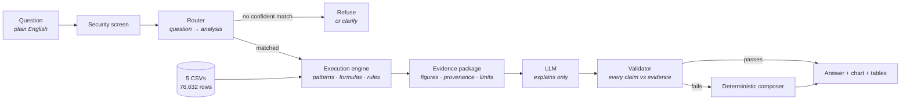

# Excel_sense_v2 — Life Insurance Analytics

Ask a life-insurance portfolio a question in plain English and get a short answer that is **computed, not generated**, with the evidence, the formula and the row counts attached. It runs on five synthetic CSVs (76,632 rows).

This is the final version in `Graph_RAG_Learn`. `ThIrD_dRAfT` is the earlier v1, and the other folders hold data design and experiments.


*Demo GIF coming soon.*

---

## The problem

An LLM asked about a dataset will give a plausible lapse rate, a top product and a reason, with no way to tell which parts came from the data and which it made up. A better prompt doesn't fix this: if the model produces the number, the number can't be trusted.

## The solution

The model never touches the data and never calculates anything.

A question selects one of **103 pre-written analyses**. Deterministic Python executes it against five CSVs, applying **18 declared formulas** and **15 business rules**. The result is an *evidence package* — figures, populations, row counts, and an explicit list of what the data **cannot** establish. Only then does the model see anything, and all it is asked to do is put the evidence into three sentences.

Then the answer is **validated back against the evidence**. A number that is not in the evidence is rejected. An entity that was never retrieved is rejected. A causal claim the data cannot support is rejected. The prompt is a request; the validator is the guarantee.

> Scripted a compromised model into saying *"the lapse rate is 95%"*. The user still receives **10.95%** — the computed figure — because the fabricated number is not in the evidence.

## Business impact

- **Every figure is auditable:** each number traces to a formula id, a population and a row count
- **Fabricated numbers can't reach the user:** the validator rejects any figure that isn't in the computed evidence
- **Refuses instead of guessing:** 8 declared unanswerable domains; 95.82% of 526 test questions routed correctly and the rest refused or clarified, never answered wrongly
- **Recurring analysis without queries:** 103 portfolio questions answered in plain English, with charts and evidence tables
- **Safe to extend:** 990 tests passing, including a regression baseline that stops new analyses from moving existing figures

## Key features

- **Conversational interface** — follow-ups reuse the previous subject; a refused turn carries nothing forward
- **103 problem statements** across 20 business domains, sharded into 15 JSON files for fast lookup
- **Deterministic engine** — 17 analytical patterns, 18 formulas, 15 business rules, all inspectable
- **Evidence-first answers** — charts, tables, provenance and stated limits with every result
- **Grounding validator** — rejects fabricated numbers, invented entities and unsupported causal claims
- **Refusal paths** — out-of-domain, unsupported-concept, invalid-entity and ambiguous questions all handled distinctly
- **Prompt-injection defence** — screening, neutralisation, prompt framing, and the validator underneath
- **Result caching** — fingerprinted on the loaded data, so a data change invalidates everything
- **Personal data protection** — personal fields are dropped during execution and re-checked before every response

---

## Architecture



**The load-bearing idea:** data flows *into* the LLM and the LLM's output flows *through* a validator. There is no path from the model back to the data.

---

## Tech stack

| Layer | Technology |
|---|---|
| Web UI | Streamlit |
| Terminal UI | argparse (stdlib only) |
| Analytics engine | pandas, NumPy |
| LLM | Groq (`llama-3.3-70b-versatile`) via `groq` SDK |
| Fallback | Deterministic composer — full functionality, no API key |
| Configuration | Generated JSON with drift tests |
| Testing | pytest — 990 tests |

---

## Workflow

1. The question is **screened** — injection and code patterns are refused before anything runs
2. The **router** scores it against 103 analyses on 8 weighted signals
3. Below the confidence floor (0.32) or too close to call → **refuse or ask for clarification**
4. The matched **execution plan** runs against the CSVs, applying declared formulas and rules
5. An **evidence package** is assembled — figures, populations, provenance, and stated limits
6. **Tables and a chart** are built from the evidence
7. The **LLM** is given the evidence and asked only to explain it
8. The answer is **validated** against the evidence; failure falls back to the deterministic composer
9. A final check asserts **no personal data** is in the response
10. The turn is **audited** — with identifiers fingerprinted, not stored

---

## Project structure

```
FInal_Run/
├── app.py                 # entry point: web UI and terminal
├── config/                # generated configs (contract, formulas, rules, prompts)
├── data/
│   ├── csv/               # the five source datasets
│   └── PS/                # 103 problem statements, sharded by domain
├── docs/                  # data profile, PS catalogue, deployment guide
├── scripts/               # profilers and config/baseline generators
├── src/
│   ├── data/              # loading, parse contract, query engine with provenance
│   ├── logic/             # formula engine, business rule engine
│   ├── analysis/          # 17 analytical patterns
│   ├── ps/                # catalogue registry, executor, evidence, cache
│   ├── router/            # question → analysis matching, with refusal paths
│   ├── evidence/          # evidence tables
│   ├── llm/               # prompt contract, summarizer, grounding validator
│   ├── security/          # input guards, dataset isolation, audit log
│   ├── api/               # chatbot orchestration & health checking
│   ├── visualization/     # charts built from the evidence
│   └── ui/                # Streamlit and terminal interfaces
└── tests/                 # 990 tests, including regression and smoke suites
```

Non-obvious folders: **`config/`** is generated from code, never hand-edited — drift tests fail if the two diverge. **`data/PS/`** holds only generated problem statements, sharded so the router loads one domain rather than all 103.

---

## Quick start

```bash
git clone -b excel_sense_v2 https://github.com/SwayamAg/ExcelSense.git
cd ExcelSense
pip install -r requirements.txt

streamlit run app.py              # web interface at localhost:8501
```

**No API key is required.** Without one, the deterministic composer writes the answers and every feature works — the model only changes how the prose reads, never what it says. To enable Groq inference:

```bash
export GROQ_API_KEY=gsk_...     # Windows: set GROQ_API_KEY=...
```

Other ways to run it:

```bash
python app.py "Which product has the highest lapse rate?"   # one-shot answer
python app.py                                               # terminal session
python app.py "..." --json                                  # machine-readable
pytest -q                                                   # the full suite
docker compose up --build                                   # container on localhost:8501, with a health check
```

Deployment details: [`docs/DEPLOYMENT.md`](docs/DEPLOYMENT.md).

---

## Example

```
$ python app.py "Which product has the highest lapse rate?"

ANSWER: P91 leads on lapse rate at 26.07%. The portfolio lapse rate across all
policies is 10.95%, so the gap is 15.13%. That is based on 4,721 policies.

  P91  ################################  26.07%
  P22  #############################     23.50%
  P53  ###########################       21.72%
  baseline ---- 10.95%

  source: from policy | population: All policies, grouped by product.
  note: Groups with fewer than 50 rows are excluded from ranking (1 excluded).

  What this analysis cannot establish
  This analysis reports observable differences. The five datasets contain no
  reason codes, payment history or contact records, so no causal explanation
  can be established from them.
```

The last paragraph is not boilerplate. It is generated because the data genuinely cannot support a causal claim, and the validator rejects any answer that makes one.

---

## Security & limitations

**Security**
- User text never becomes a query — it selects from a fixed catalogue, so there is nothing to inject into
- Five allow-listed files; no path is ever derived from user input
- Personal fields removed during execution *and* re-checked on every response before it is returned
- Injection, rule-tampering and code patterns refused before any analysis runs — with **zero false positives** across all 526 catalogue example queries
- Audit log fingerprints identifiers rather than storing them

**Limitations — stated plainly**
- **Synthetic data.** The five CSVs are generated for demonstration; the figures are real computations over unreal data
- **103 analyses, not open-ended SQL.** A question outside the catalogue is refused, by design
- **95.82% routing accuracy** on 526 example queries. The remainder are refusals or clarification requests, not wrong answers
- **No causal inference.** The data has no reason codes or payment history, so "why" questions return observable differences and say so
- **No authentication.** Every user sees the same portfolio-level analysis
- **No rate limiting.** Question length and result size are capped; request volume is not
- Injection detection is lexical and will not catch every phrasing — it is layered, not relied upon

---

## Roadmap

- Authentication and per-user data scoping
- Rate limiting
- Streaming answers in the web interface
- Broadening the catalogue beyond 103 analyses
- Real-data connectors to replace flat-file loading

---

## Documentation

| Document | Contents |
|---|---|
| [`docs/DATA_PROFILE.md`](docs/DATA_PROFILE.md) | Column-level profile and 13 data-quality findings |
| [`docs/PROBLEM_STATEMENT_CATALOGUE.md`](docs/PROBLEM_STATEMENT_CATALOGUE.md) | All 103 analyses |
| [`docs/TEST_REPORT.md`](docs/TEST_REPORT.md) | Generated from an actual run — coverage and measured latency |
| [`PROJECT_STATUS.md`](PROJECT_STATUS.md) | Phase-by-phase expected vs delivered vs test status |

---

## Author

**Swayam Agarwal**

- LinkedIn: [linkedin.com/in/swayam-agarwal](https://www.linkedin.com/in/swayam-agarwal/)
- GitHub: [@SwayamAg](https://github.com/SwayamAg)
- Email: [swayamagarwal19@gmail.com](mailto:swayamagarwal19@gmail.com)

## License

Not specified yet. No license file has been added.
